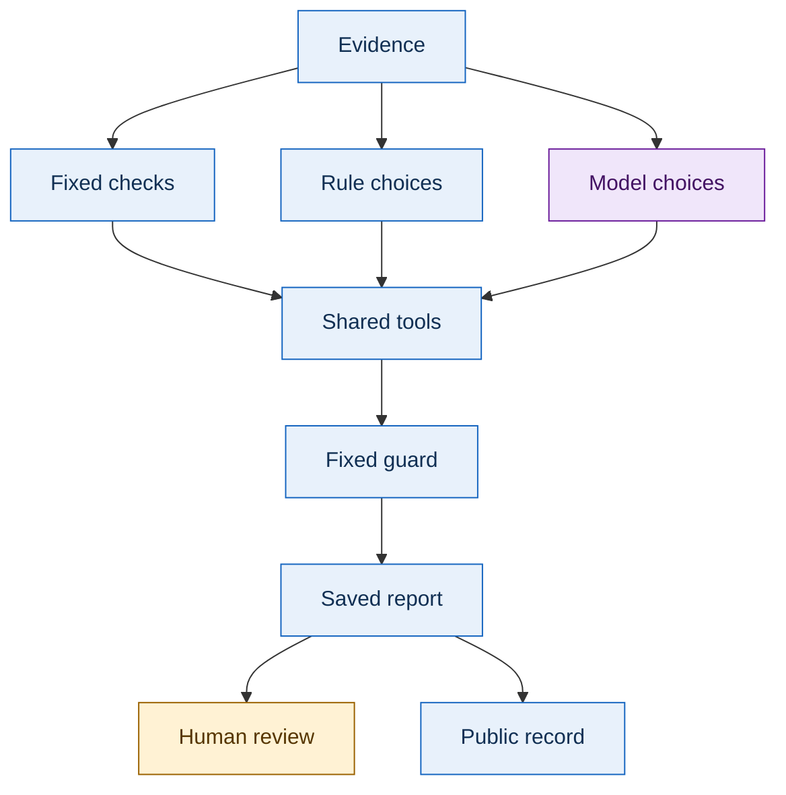
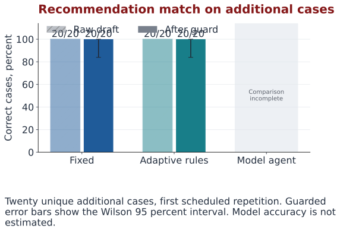

# A CONFORMANCE HARNESS FOR VERIFIABLE MODULAR OPEN SYSTEMS OUTCOMES IN DEFENSE ACQUISITION: DESIGN, IMPLEMENTATION, AND CONTROLLED EVALUATION

**Revised research draft with an agent supported evidence review study.** By Daren Jadiel Diaz. This is a companion for readers and the thesis committee. Publication does not mean that the revised draft has been approved.

[Read the public website](https://cloudwizardboricua.github.io/mosa-evidence-review-thesis/) · [Read the revised thesis](docs/thesis.md) · [Explore a saved review](docs/review.md) · [Compare the evidence](docs/results.md)

> **Research question:** When does an agent help a person review evidence for the Modular Open Systems Approach, and what checks are needed to keep its recommendations reliable?

The Modular Open Systems Approach, abbreviated **MOSA**, means designing systems so components can be inspected, replaced, and upgraded through clearly defined connections. A review asks whether the supplied records support those claims. An agent can choose which checks to request, but its recommendation still needs evidence, fixed rules, and a person responsible for the final decision.

The confirmed earlier thesis remains unchanged. The new document keeps the same title and narrows the argument to evidence review. The class capstone stays in its course repository until course submission and a tested migration.

## Choose a reading path

| Step | What you will learn | Where to go |
| --- | --- | --- |
| 1. Start Here | The problem, research question, and limits | [Reader guide](docs/index.md) |
| 2. Read the Thesis | Revised source, chapter guide, and download status | [Thesis guide](docs/thesis.md) |
| 3. Follow One Review | What the tools checked and why a decision changed | [Saved review explorer](docs/review.md) |
| 4. Compare Results | Which findings come from which study | [Results and data](docs/results.md) |
| 5. Understand the Terms | Meanings, examples, and why each term matters | [Searchable glossary](docs/glossary.md) |
| 6. Reproduce the Study | How to inspect or repeat the evidence | [Reproduction instructions](docs/reproduce.md) |

Committee readers can begin with the thesis abstract, examine one review, and then compare the primary evaluation with its limitations. Technical readers can continue to the recorded data and offline checks.

## Color guide

Colors help readers follow a diagram. Every color also has a word label, so color alone never carries a decision.

| Color | Label | Meaning |
| --- | --- | --- |
| 🔵 Blue | Evidence and fixed checks | Source records and checks with explicit rules |
| 🟣 Purple | Agent choices | A model chooses a permitted next action |
| 🟢 Green | Ready | The required checks support readiness within this research profile |
| 🟠 Amber | Further review | Evidence is missing, unknown, or incomplete |
| 🔴 Crimson | Blocking problem | A known problem prevents readiness |

The main website accent is OU crimson, `#841617`. OU means the University of Oklahoma. The colors support reading and do not imply university approval.

## How the system fits together





**Complex term explained: decision guard.** A guard is a set of fixed checks applied to a recommendation. For example, it can change a model's claim of readiness to further review when a required tool did not finish. This matters because a convincing explanation alone cannot establish that the evidence was checked.

[See the review, approval, rollback, and migration diagrams](docs/diagrams.md).

## What the evidence currently shows

**Amber: the new model comparison is incomplete.** The fixed and rule based methods completed the new benchmark. The model method's first hosted request failed with an HTTP 404 response. HTTP means Hypertext Transfer Protocol, the rules used for web requests; 404 means the requested web resource was not found. Its service charge was unknown, so the budget control stopped paid work. The new study therefore does not establish model accuracy or a complete three method comparison. The earlier pilot remains separate evidence.

<!-- BEGIN VERIFIED RESULTS -->
### Original conformance experiment

**Status:** recorded. Unique cases: 20. Recorded runs: 40.

| Method | Known faults detected | Controls accepted | Median elapsed time, ms |
| --- | ---: | ---: | ---: |
| Minimal baseline | 5/18 | 2/2 | 0.348 |
| Original conformance harness | 18/18 | 2/2 | 7.042 |

This earlier experiment compares different check sets. Its runtime and outcome measures are separate from the agent studies.

[Inspect the recorded source](https://github.com/CloudWizardBoricua/mosa-evidence-review-thesis/blob/main/evidence/legacy/statistical_summary.json).

### Earlier capstone pilot

**Status:** recorded. Unique cases: 20. Recorded runs: 40.

| Method | Unique cases | Recorded runs | Raw correct | Guarded correct | Tool invocations | Median elapsed time, ms | Recorded cost, USD |
| --- | ---: | ---: | ---: | ---: | ---: | ---: | ---: |
| Fixed workflow | 20 | 20 | 20/20 (100.0%) | 20/20 (100.0%) | 60 | 4.98 | 0 |
| Model agent | 20 | 20 | 17/20 (85.0%) | 20/20 (100.0%) | 51 | 3,916.684 | 0.020573 |

These descriptive-name development cases were run once per method. This pilot is separate from the neutral-case study.

The pilot measured distinct validator names; this study counts every validator trace event.

Its original citation measure checked nonempty strings and is not evidence of location validation.

[Inspect the recorded source](https://github.com/CloudWizardBoricua/mosa-evidence-review-thesis/blob/main/evidence/pilot/hosted_analysis.json).

### New benchmark: additional-case evaluation

**Status:** incomplete. Unique cases: 20. Recorded runs: 121.

| Method | Unique cases | Recorded runs | Raw correct | Guarded correct | Tool invocations | Median elapsed time, ms | Recorded cost, USD |
| --- | ---: | ---: | ---: | ---: | ---: | ---: | ---: |
| Fixed workflow | 20 | 60 | 20/20 (100.0%) | 20/20 (100.0%) | 180 | 5.009 | 0 |
| Rule based adaptive workflow | 20 | 60 | 20/20 (100.0%) | 20/20 (100.0%) | 162 | 4.969 | 0 |
| Model agent | 20 | 1 | Not reported | Not reported | 0 | Not reported | Not reported |

**Model agent: incomplete.** 1 of 60 planned runs recorded; 0 completed reviews with timing; 1 failed runs. A complete recommendation accuracy comparison is not available.

| Method | Missed findings | Extra findings | Valid references | Guard interventions | Fully repeated stable cases | Tokens |
| --- | ---: | ---: | ---: | ---: | ---: | ---: |
| Fixed workflow | 0 | 3 | 45/45 | 0 | 20/20 | 0 |
| Rule based adaptive workflow | 0 | 0 | 42/42 | 3 | 20/20 | 0 |
| Model agent | 1 | 0 | 0/0 | 1 | 0/0 | Not reported |

Findings, references, and guard interventions count recorded runs. Stable case counts require all planned repeats. These counts use a different denominator from unique-case recommendation accuracy.

Accuracy uses repetition 1 on each unique case. Three repetitions describe timing and stability.

An offline preflight led to a documented hash-container fix before the final freeze. These are additional synthetic cases, not untouched external holdout evidence.

Daren Diaz verification and independent label review are pending. This profile does not certify a defense system.

[Inspect the recorded source](https://github.com/CloudWizardBoricua/mosa-evidence-review-thesis/blob/main/evidence/study40/summary.json).

### New benchmark: development cases

**Status:** incomplete. Unique cases: 20. Recorded runs: 120.

| Method | Unique cases | Recorded runs | Raw correct | Guarded correct | Tool invocations | Median elapsed time, ms | Recorded cost, USD |
| --- | ---: | ---: | ---: | ---: | ---: | ---: | ---: |
| Fixed workflow | 20 | 60 | 20/20 (100.0%) | 20/20 (100.0%) | 180 | 5.12 | 0 |
| Rule based adaptive workflow | 20 | 60 | 20/20 (100.0%) | 20/20 (100.0%) | 156 | 5.033 | 0 |
| Model agent | 20 | 0 | Not executed | Not executed | Not executed | Not reported | Not reported |

**Model agent: pending.** 0 of 60 planned runs recorded; 0 completed reviews with timing; 0 failed runs. A complete recommendation accuracy comparison is not available.

| Method | Missed findings | Extra findings | Valid references | Guard interventions | Fully repeated stable cases | Tokens |
| --- | ---: | ---: | ---: | ---: | ---: | ---: |
| Fixed workflow | 0 | 9 | 60/60 | 0 | 20/20 | 0 |
| Rule based adaptive workflow | 0 | 0 | 51/51 | 0 | 20/20 | 0 |
| Model agent | Not executed | Not executed | Not executed | Not executed | Not executed | Not executed |

Findings, references, and guard interventions count recorded runs. Stable case counts require all planned repeats. These counts use a different denominator from unique-case recommendation accuracy.

Accuracy uses repetition 1 on each unique case. Three repetitions describe timing and stability.

An offline preflight led to a documented hash-container fix before the final freeze. These are additional synthetic cases, not untouched external holdout evidence.

Daren Diaz verification and independent label review are pending. This profile does not certify a defense system.

[Inspect the recorded source](https://github.com/CloudWizardBoricua/mosa-evidence-review-thesis/blob/main/evidence/study40/summary.json).

**New study budget:** $5 ceiling; recorded spending: Not reported. Unknown cost is never treated as zero.

**Paid study stopped:** Request failed and its provider charge is unknown.

Accuracy counts unique cases. Repeated runs measure stability and timing. Pilot invocation counts retain the original evaluator's definition; the new benchmark counts actual trace events.
<!-- END VERIFIED RESULTS -->

The three datasets answer different questions. The original study tested known faults in synthetic software modules. The pilot tested agent choices on 20 evidence packages. The new benchmark compares fixed checks, rule based choices, and model choices on separate development and evaluation cases. None of these studies is certification of a defense program or evidence of operational performance.

| Visual | What it shows |
| --- | --- |
| [Recommendation accuracy](docs/assets/accuracy.svg) | Recommendations before and after the guard |
| [Validation effort](docs/assets/effort.svg) | Actual tool invocations, including repeat calls |
| [Elapsed time](docs/assets/latency.svg) | How long a review took |
| [Recorded cost](docs/assets/cost.svg) | Reported model service charges |
| [Individual cases](docs/assets/case_outcomes.svg) | Variation across cases instead of only an average |



[Open the accessible result tables](docs/results.md) · [Read the research design](docs/research-design.md)

## Repository map

| Folder or file | Purpose |
| --- | --- |
| `docs/` | Plain language reading website, glossary, diagrams, and downloads |
| `thesis/` | Revised thesis source and document generation records |
| `evidence/legacy/` | Recorded results from the original conformance harness study |
| `evidence/pilot/` | Sanitized capstone pilot results |
| `evidence/study/` | New benchmark cases, labels, frozen settings, and recorded runs when available |
| `prototypes/legacy-harness/` | Preserved original prototype and inherited notices |
| `tests/` | Offline checks for published evidence and website integrity |
| `tools/` | Reproduction, public export, and document build utilities |
| `.github/workflows/` | Verification and public website deployment |

The new capstone implementation remains in the class repository. [Migration instructions](docs/migration.md) explain how to export a tested release later while preserving the class history.

## Inspect and build locally

These commands use Python 3.11 and run from the repository root. Python is the programming language used by the research tools. A virtual environment keeps this project's installed packages separate from other projects.

```bash
python -m venv .venv
```

Activate the environment with `source .venv/bin/activate` on Linux or macOS. In Windows PowerShell, use `.\.venv\Scripts\Activate.ps1`.

```bash
python -m pip install -r requirements-site.txt
python tools/render_public_data.py
python -m unittest discover -s tests -p "test_public_site.py"
node --test tests/test_reader_interactions.js
python -m mkdocs build --strict
python -m mkdocs serve
```

The website reads saved JSON files. JSON means JavaScript Object Notation, a structured text format for exchanging records. The public website has no live agent service and cannot approve, apply, or reverse a review. These actions belong to the private prototype and its responsible human reviewer.

Node.js runs the optional browser interaction checks locally and the required checks in continuous integration. It is a JavaScript runtime, which means it executes the language used by the saved review filters.

[Complete reproduction instructions](docs/reproduce.md) include the original harness and the new study's current execution status. Building the website does not call a paid model.

## Research limits and author rights

All examples are synthetic research examples. The benchmark's expected answers are researcher labels; independent review must be recorded before it can be claimed. Repeated runs measure timing and stability, while unique cases support accuracy estimates. Fewer tool calls can reduce validation effort without reducing total time, service cost, or reviewer effort.

The author retains rights under [LICENSE](LICENSE). Inherited notices remain in place. The legacy artifact has conflicting license metadata, described in [Sources and Rights](docs/sources.md); this repository does not adopt its citation file's MIT label as a new license.

Use [CITATION.cff](CITATION.cff) to cite this companion. Identify the draft, source commit, and dataset used so another reader can inspect the same evidence.
