# MOSA Evidence Review Thesis

**A research companion for the thesis committee, evidence reviewers, and developers.**

**Author:** Daren Jadiel Diaz  
**Companion version:** 0.1.0  
**Frozen study:** `thesis-study40-v1`  
**Publication status:** Original and revised thesis PDFs available; the revision remains a research draft.

> **Formal thesis title**  
> A CONFORMANCE HARNESS FOR VERIFIABLE MODULAR OPEN SYSTEMS OUTCOMES IN DEFENSE ACQUISITION: DESIGN, IMPLEMENTATION, AND CONTROLLED EVALUATION

**Read the complete thesis:** [Original PDF (130 pages)](docs/assets/downloads/thesis-original.pdf) · [Revised PDF (52 pages)](docs/assets/downloads/thesis-revised.pdf)

[Reading website](https://cloudwizardboricua.github.io/mosa-evidence-review-thesis/) · [PDF downloads and chapter guide](docs/thesis.md) · [Saved review explorer](docs/review.md) · [Results](docs/results.md) · [Reproduction guide](docs/reproduce.md)

> **Research question:** When does an agent help a person review evidence for the Modular Open Systems Approach, and what checks are needed to keep its recommendations reliable?

The **Modular Open Systems Approach (MOSA)** concerns systems whose components can be inspected, replaced, and upgraded through defined connections. This project examines evidence behind those claims: records of interfaces, software components, tests, and artifact provenance. It compares how fixed rules and a model choose checks, then applies a shared guard before presenting a recommendation for human review.

## At a glance

| Item | Recorded scope or current status | Inspect the source |
| --- | --- | --- |
| Original conformance study | 20 synthetic modules: 18 faulty variants and 2 controls | [Original summary](evidence/legacy/statistical_summary.json) |
| Earlier agent pilot | 20 cases, 2 methods, 40 recorded runs | [Pilot analysis](evidence/pilot/hosted_analysis.json) |
| New benchmark | 40 synthetic cases: 20 development and 20 additional | [Labels](evidence/study40/labels.json) |
| Planned new comparison | 3 methods × 40 cases × 3 repetitions = 360 runs | [Settings](evidence/study40/settings.json) |
| Recorded new comparison | 241 attempts: 240 completed offline reviews and 1 failed model request | [Rows](evidence/study40/rows.json) |
| Paid model study | Incomplete; stopped after HTTP 404 and unknown provider charge | [Budget ledger](evidence/study40/budget.json) |
| Spending ceiling | $5 for the new study; actual charge unresolved | [Public summary](docs/assets/study_summary.json) |
| Label review | Author verification and independent review pending | [Review status](evidence/study40/labels.json) |
| Thesis documents | Original 130-page PDF and revised 52-page research draft | [Original PDF](docs/assets/downloads/thesis-original.pdf), [revised PDF](docs/assets/downloads/thesis-revised.pdf) |
| Public interface | Reading site with saved records and filters | [Reader](docs/assets/javascripts/readers.js) |
| Current capstone | Remains in class repository; migration is future work | [Migration guide](docs/migration.md) |

**How to read the results:** the fixed and rule based methods completed the new offline schedules. The model method did not complete a review in that study. Its missing accuracy, timing, and cost estimates remain unavailable. The earlier pilot is separate evidence. Publication does not establish committee approval or defense system certification.

## Contents

| Understand the project | Inspect the evidence | Reproduce and extend |
| --- | --- | --- |
| [1. Reading paths](#1-reading-paths) | [6. Recorded results](#6-recorded-results) | [13. Quick start](#13-quick-start) |
| [2. Research scope](#2-research-scope) | [7. Chart gallery](#7-chart-gallery) | [14. Verification and publication](#14-verification-and-publication) |
| [3. System architecture](#3-system-architecture) | [8. Dataset catalog](#8-dataset-catalog) | [15. Thesis source and document status](#15-thesis-source-and-document-status) |
| [4. Review and human decision lifecycle](#4-review-and-human-decision-lifecycle) | [9. Frozen case catalog](#9-frozen-case-catalog) | [16. Research limits](#16-research-limits) |
| [5. Evaluation design](#5-evaluation-design) | [10. Data dictionary](#10-data-dictionary) | [17. Roadmap and migration](#17-roadmap-and-migration) |
| [Color and terminology](#color-and-terminology) | [11. Worked evidence review](#11-worked-evidence-review) | [18. Citation and rights](#18-citation-and-rights) |
| [12. Repository map](#12-repository-map) | [Provenance and file integrity](#provenance-and-file-integrity) | [Maintaining this companion](#maintaining-this-companion) |

---

## 1. Reading paths

| Reader | Suggested route | What to look for |
| --- | --- | --- |
| Thesis committee | [Revised thesis PDF](docs/assets/downloads/thesis-revised.pdf) → [Design](docs/research-design.md) → [Results](#6-recorded-results) → [Limits](#16-research-limits) | Whether the argument follows the evidence and acknowledges unfinished work |
| New to MOSA | [Reader guide](docs/index.md) → [Architecture](#3-system-architecture) → [Example](#11-worked-evidence-review) → [Glossary](docs/glossary.md) | How a modularity claim becomes a checkable question |
| Evidence reviewer | [Review explorer](docs/review.md) → [Case catalog](#9-frozen-case-catalog) → [Dictionary](#10-data-dictionary) | Source fields, findings, and guard interventions |
| Researcher or analyst | [Datasets](#8-dataset-catalog) → [Design](#5-evaluation-design) → [CSV tables](#machine-readable-chart-tables) → [Reproduction](docs/reproduce.md) | Denominators, failures, missing values, and dataset boundaries |
| Developer | [Map](#12-repository-map) → [Quick start](#13-quick-start) → [Checks](#14-verification-and-publication) → [Migration](#17-roadmap-and-migration) | Building the site and preserving evidence |

The website offers search, a glossary, a chapter guide, and filters over saved reviews. This README provides a self-contained overview with direct evidence links.

## 2. Research scope

### The problem

A component can appear modular while interfaces, dependencies, test records, or source fingerprints contradict that claim. Reviewers need inspectable evidence and explicit criteria. An agent's explanation is useful only when findings refer to supplied artifacts and its recommendation respects required checks.

### Contributions and artifacts

| Contribution | Included material | Inspect it |
| --- | --- | --- |
| Conformance foundation | Harness, candidate modules, protocol, schemas, outputs, figures | [Legacy prototype](prototypes/legacy-harness/) |
| Review-strategy comparison | Fixed, adaptive rules, bounded model, shared tools | [Research design](docs/research-design.md) |
| Frozen evaluation record | Neutral IDs, labels, settings, prompt, hashes, rows, traces | [Benchmark](evidence/study40/) |
| Traceable reporting | Generated tables; figures with exact CSVs | [Results](docs/results.md), [figure manifest](docs/assets/figures/figure_manifest.json) |
| Evidence inspection | Filters, tool events, references, raw/guarded recommendations | [Review guide](docs/review.md), [saved records](docs/assets/reviews.json) |
| Document/release continuity | Thesis source, figure map, builders, future migration | [Thesis](thesis/), [migration](docs/migration.md) |

### Three distinct studies

| Study | Main question | Comparison unit | Boundary |
| --- | --- | --- | --- |
| Original conformance | Can a more complete harness detect known faults? | Module × method | Different check sets; independent of agent selection |
| Earlier pilot | Can a model choose checks and produce useful guarded recommendations? | Case × method, one run | Earlier configuration and descriptive names |
| New benchmark | How do fixed, rule based, and model choices compare under a frozen profile? | Case × method × repetition | Offline complete; hosted comparison incomplete |

Keep the studies separate when interpreting accuracy, latency, tool counts, and charge. They have different configurations and measurement definitions.

## 3. System architecture

### Shared evidence and safeguards

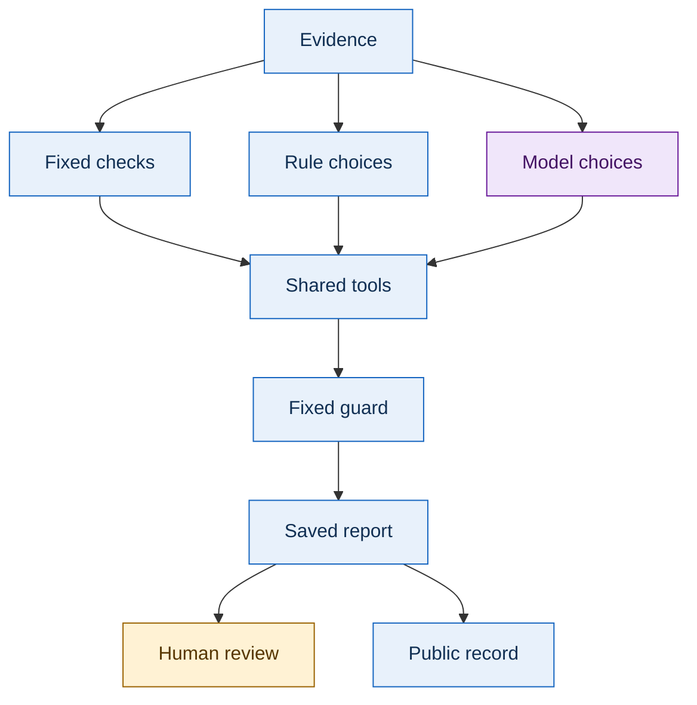

[Mermaid source](diagrams/system_topology.mmd) · [SVG](docs/assets/diagrams/system_topology.svg) · [PNG fallback](docs/assets/diagrams/system_topology.png)

All three methods receive the same evidence package and share the validator interface and decision guard. A **validator** checks a defined property of supplied records. A **decision guard** checks the recommendation's support and coverage before saving it for inspection.

| Method | Data identifier | Check selection | Comparison boundary |
| --- | --- | --- | --- |
| Fixed workflow | `baseline` | Requests all three validators in fixed order | Complete fixed check path |
| Rule based adaptive | `adaptive` | Explicit rules and tool results determine order and stopping | Validation work within the same profile |
| Model agent | `openrouter` | Model chooses permitted tools in a bounded loop | Adds provider latency, model uncertainty, usage, and budget constraints |

### Validator responsibilities

| Tool | Main evidence | Represented checks | Scope boundary |
| --- | --- | --- | --- |
| `inspect_evidence_package` | Manifest, tests, provenance, inventory | Required records, parseability, identities, test counts/failures, fingerprints | Hashes establish byte consistency, not signer authenticity |
| `validate_interface_contract` | Manifest and interface | Version, endpoint, response type, dependency consistency | Selected rules; not complete OpenAPI validation |
| `verify_sbom_and_advisories` | SBOM and advisory fixture | Inventory fields, component identities/versions, fixture matches | Selected CycloneDX profile; synthetic dated advisories; live lookup disabled |

An **SBOM**, or Software Bill of Materials, lists components. An **interface contract** specifies the agreed connection between components. **Provenance** records an artifact's source and identity.

### Evidence package structure

A typical package has five files. Cases may deliberately omit or corrupt them.

```text
c0001/
├── manifest.json      Module/build identity and declared contract
├── interface.json     Version, endpoints, response structure
├── sbom.json          Software component inventory
├── tests.json         Test totals and outcome counts
└── provenance.json    Source, creation time, artifact hashes
```

[Worked package](evidence/study40/packages/c0001/) · [All packages](evidence/study40/packages/)

### Color and terminology

| Cue | Text label | Meaning |
| --- | --- | --- |
| Blue | Evidence and fixed checks | Records and explicit rules |
| Purple | Agent choices | Permitted controller/model actions |
| Green | Ready / `ready` | Meets required checks within this profile |
| Amber | Further review / `needs_review` | Evidence missing, unknown, or incomplete |
| Crimson | Blocking problem / `not_ready` | Known problem prevents profile readiness |
| Gray | Unavailable / failed / unattempted | No completed observation; labels distinguish states |

Every state has a text label. The website accent is OU crimson, `#841617`; OU means University of Oklahoma. Branding does not imply endorsement. See the [glossary](docs/glossary.md).

## 4. Review and human decision lifecycle

### From evidence to guarded recommendation

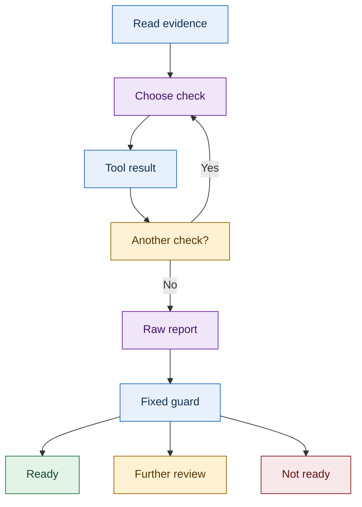

[Mermaid source](diagrams/review_sequence.mmd) · [SVG](docs/assets/diagrams/review_sequence.svg) · [PNG fallback](docs/assets/diagrams/review_sequence.png)

1. Read the package and preserve its identity.
2. Choose a permitted validator and inspect the facts.
3. Request further checks within the method and loop limits.
4. Produce a raw recommendation and findings.
5. Apply the fixed guard.
6. Save recommendations, findings, events, references, and metrics.
7. Present the record to a responsible human reviewer.

**Raw** means before the guard; **guarded** means after it. A correct disposition can still contain extra findings or incomplete coverage, so those measures remain separate.

### Human approval and rollback

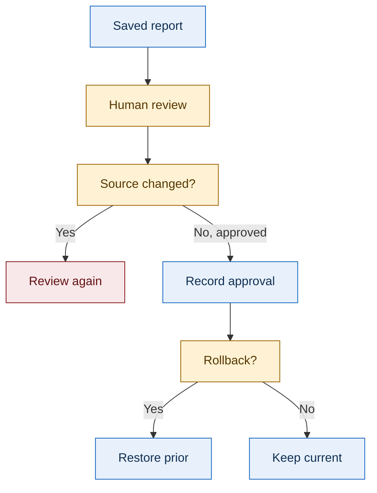

[Mermaid source](diagrams/approval_rollback.mmd) · [SVG](docs/assets/diagrams/approval_rollback.svg) · [PNG fallback](docs/assets/diagrams/approval_rollback.png)

This diagram describes the private prototype. Human review checks the evidence fingerprint before approval. Changed evidence requires another review. Rollback restores a prior approved pointer and appends history.

The public website reads saved records. It does not run an agent, record live approvals, or perform rollback. Private approval pointers and notes are excluded.

## 5. Evaluation design

### Benchmark composition

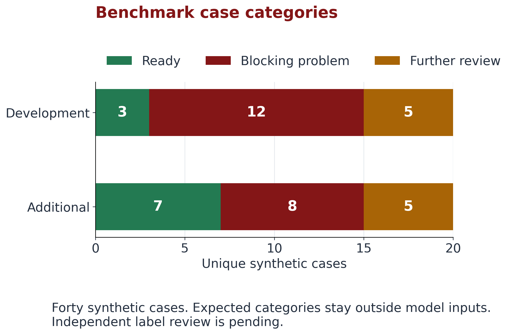

[CSV](docs/assets/figures/benchmark_split.csv) · [SVG](docs/assets/figures/benchmark_split.svg) · [Labels](evidence/study40/labels.json)

| Split | Identifier | Ready | Blocking | Further review | Unique cases |
| --- | --- | ---: | ---: | ---: | ---: |
| Development | `development` | 3 | 12 | 5 | 20 |
| Additional evaluation | `heldout` | 7 | 8 | 5 | 20 |
| Total | Both | 10 | 20 | 10 | 40 |

`heldout` remains the exported identifier. Additional cases were inspected during a preflight that revealed a structural bug. They are a separately reported synthetic split, not untouched external holdout evidence.

### Frozen settings

These describe the saved configuration rather than current provider capabilities or prices.

| Setting | Value | Purpose |
| --- | --- | --- |
| Study | `thesis-study40-v1` | Evidence snapshot |
| Profile | `mosa-course-profile-0.1` | Rules and scope |
| Prompt version | `mosa-review-0.1` | Instructions |
| Model | `openai/gpt-4.1-mini` through OpenRouter | Intended hosted method |
| Temperature | `0` | Requested setting; not proof of repeatability |
| Maximum output tokens | `1200` | Response bound |
| Model turn limit | `4` | Loop bound |
| Request attempt limit | `2` | Retry bound |
| Repetitions | `3` per case/method | Timing/stability |
| Mode order | `baseline`, `adaptive`, `openrouter` | Schedule |
| Advisories | Synthetic dated fixture; live lookup disabled | Scope |
| Budget | `$5` | Planned provider-spending ceiling |

Sources: [settings](evidence/study40/settings.json), [system prompt](evidence/study40/system_prompt.txt).

### Measurement rules

| Measure | Grain / denominator | Interpretation |
| --- | --- | --- |
| Correctness | Repetition 1; 20 unique cases per split/method | Researcher-label agreement before/after guard |
| Accuracy uncertainty | Wilson 95% interval over first-run cases | Recorded offline interval |
| Missed / extra findings | Exact finding-ID sets across recorded runs | Omitted / unsupported issues |
| Reference validity | Artifact and field location | Stronger than nonempty strings |
| Tool invocations | Every event across recorded repeats | Repeated calls count; pilot definition differs |
| Review time | Completed runs; median and spread | Failed request duration separate |
| Tokens and charge | Reported request/run usage | Missing charge stays unknown |
| Guard intervention | Recorded change or constraint | Can occur even when dispositions match |
| Stability | Fully repeated cases | Repeats do not increase independent sample size |

The schedule is **40 × 3 × 3 = 360 runs**. Each offline method completed 120; the model recorded one failure. The source summary's `completed_runs` field contains 241 recorded slots including that failure. Use row `status` to distinguish completed reviews from attempts.

### Budget accounting

The ledger's `accounted_usd = 0.00936056` is an unresolved reservation. Aggregate `reported_usd = 0` does not establish a zero charge: the failed event has reported charge `null`. Execution stopped because the request failed and its charge is unknown.

Further paid work requires charge reconciliation and verified request compatibility in the private study. Building this site makes no provider request. [Ledger](evidence/study40/budget.json) · [Design](docs/research-design.md).

## 6. Recorded results

The tables below are generated from [the public summary](docs/assets/study_summary.json) by [render_public_data.py](tools/render_public_data.py). Their marked block is checked in the verification workflow.

**Current finding:** both offline methods match all first-run recommendation labels on both 20-case splits. On additional cases, adaptive rules use 162 validator calls versus 180 for fixed checks: **18 fewer calls, or 10% less measured validation effort**, across the same 60 completed reviews. That does not establish lower total cost or human reviewer workload.

<!-- BEGIN VERIFIED RESULTS -->
### Original conformance experiment

**Status:** recorded. Unique cases: 20. Recorded runs: 40.

| Method | Known faults detected | Controls accepted | Median elapsed time, ms |
| --- | ---: | ---: | ---: |
| Minimal baseline | 5/18 | 2/2 | 0.348 |
| Original conformance harness | 18/18 | 2/2 | 7.042 |

This earlier experiment compares different check sets. Its runtime and outcome measures are separate from the agent studies.

[Inspect the recorded source](https://github.com/CloudWizardBoricua/mosa-evidence-review-thesis/blob/main/evidence/legacy/statistical_summary.json).

### Earlier capstone pilot

**Status:** recorded. Unique cases: 20. Recorded runs: 40.

| Method | Unique cases | Recorded runs | Raw correct | Guarded correct | Tool invocations | Median elapsed time, ms | Recorded cost, USD |
| --- | ---: | ---: | ---: | ---: | ---: | ---: | ---: |
| Fixed workflow | 20 | 20 | 20/20 (100.0%) | 20/20 (100.0%) | 60 | 4.98 | 0 |
| Model agent | 20 | 20 | 17/20 (85.0%) | 20/20 (100.0%) | 51 | 3,916.684 | 0.020573 |

These descriptive-name development cases were run once per method. This pilot is separate from the neutral-case study.

The pilot measured distinct validator names; this study counts every validator trace event.

Its original citation measure checked nonempty strings and is not evidence of location validation.

[Inspect the recorded source](https://github.com/CloudWizardBoricua/mosa-evidence-review-thesis/blob/main/evidence/pilot/hosted_analysis.json).

### New benchmark: additional-case evaluation

**Status:** incomplete. Unique cases: 20. Recorded runs: 121.

| Method | Unique cases | Recorded runs | Raw correct | Guarded correct | Tool invocations | Median elapsed time, ms | Recorded cost, USD |
| --- | ---: | ---: | ---: | ---: | ---: | ---: | ---: |
| Fixed workflow | 20 | 60 | 20/20 (100.0%) | 20/20 (100.0%) | 180 | 5.009 | 0 |
| Rule based adaptive workflow | 20 | 60 | 20/20 (100.0%) | 20/20 (100.0%) | 162 | 4.969 | 0 |
| Model agent | 20 | 1 | Not reported | Not reported | 0 | Not reported | Not reported |

**Model agent: incomplete.** 1 of 60 planned runs recorded; 0 completed reviews with timing; 1 failed runs. A complete recommendation accuracy comparison is not available.

| Method | Missed findings | Extra findings | Valid references | Guard interventions | Fully repeated stable cases | Tokens |
| --- | ---: | ---: | ---: | ---: | ---: | ---: |
| Fixed workflow | 0 | 3 | 45/45 | 0 | 20/20 | 0 |
| Rule based adaptive workflow | 0 | 0 | 42/42 | 3 | 20/20 | 0 |
| Model agent | 1 | 0 | 0/0 | 1 | 0/0 | Not reported |

Findings, references, and guard interventions count recorded runs. Stable case counts require all planned repeats. These counts use a different denominator from unique-case recommendation accuracy.

Accuracy uses repetition 1 on each unique case. Three repetitions describe timing and stability.

An offline preflight led to a documented hash-container fix before the final freeze. These are additional synthetic cases, not untouched external holdout evidence.

Daren Diaz verification and independent label review are pending. This profile does not certify a defense system.

[Inspect the recorded source](https://github.com/CloudWizardBoricua/mosa-evidence-review-thesis/blob/main/evidence/study40/summary.json).

### New benchmark: development cases

**Status:** incomplete. Unique cases: 20. Recorded runs: 120.

| Method | Unique cases | Recorded runs | Raw correct | Guarded correct | Tool invocations | Median elapsed time, ms | Recorded cost, USD |
| --- | ---: | ---: | ---: | ---: | ---: | ---: | ---: |
| Fixed workflow | 20 | 60 | 20/20 (100.0%) | 20/20 (100.0%) | 180 | 5.12 | 0 |
| Rule based adaptive workflow | 20 | 60 | 20/20 (100.0%) | 20/20 (100.0%) | 156 | 5.033 | 0 |
| Model agent | 20 | 0 | Not executed | Not executed | Not executed | Not reported | Not reported |

**Model agent: pending.** 0 of 60 planned runs recorded; 0 completed reviews with timing; 0 failed runs. A complete recommendation accuracy comparison is not available.

| Method | Missed findings | Extra findings | Valid references | Guard interventions | Fully repeated stable cases | Tokens |
| --- | ---: | ---: | ---: | ---: | ---: | ---: |
| Fixed workflow | 0 | 9 | 60/60 | 0 | 20/20 | 0 |
| Rule based adaptive workflow | 0 | 0 | 51/51 | 0 | 20/20 | 0 |
| Model agent | Not executed | Not executed | Not executed | Not executed | Not executed | Not executed |

Findings, references, and guard interventions count recorded runs. Stable case counts require all planned repeats. These counts use a different denominator from unique-case recommendation accuracy.

Accuracy uses repetition 1 on each unique case. Three repetitions describe timing and stability.

An offline preflight led to a documented hash-container fix before the final freeze. These are additional synthetic cases, not untouched external holdout evidence.

Daren Diaz verification and independent label review are pending. This profile does not certify a defense system.

[Inspect the recorded source](https://github.com/CloudWizardBoricua/mosa-evidence-review-thesis/blob/main/evidence/study40/summary.json).

**New study budget:** $5 ceiling; recorded spending: Not reported. Unknown cost is never treated as zero.

**Paid study stopped:** Request failed and its provider charge is unknown.

Accuracy counts unique cases. Repeated runs measure stability and timing. Pilot invocation counts retain the original evaluator's definition; the new benchmark counts actual trace events.
<!-- END VERIFIED RESULTS -->

### Interpretation

| Observation | Supported reading | Unresolved question |
| --- | --- | --- |
| Original harness: 18/18 known faults; minimal baseline: 5/18 | More complete checks detect more of these planted defects | Operational systems and faults outside the synthetic set |
| Pilot model: 17/20 raw and 20/20 guarded | Safeguards correct three pilot recommendation mismatches | Whether that pattern holds in the new study |
| Offline methods: 20/20 first-run matches on each new split | Explicit rules suffice for these recorded labels | Generalization, label quality, unfinished model comparison |
| Additional fixed: 3 extra findings across repeats; rules: 0 | Disposition and finding correctness differ | Effects on human review effort and trust |
| Additional rules: 3 guard interventions | Guard remains relevant despite perfect disposition agreement | Behavior under different inputs or tool availability |
| New model: one failed request, remaining slots unattempted | Hosted schedule is incomplete | Accuracy, successful-review time, charge, repeatability |

The recorded Wilson 95% interval for each completed offline additional-case accuracy estimate is approximately **83.9% to 100%**. Perfect agreement on 20 synthetic cases should be read alongside that small denominator and pending label review. [Source groups](evidence/study40/summary.json) · [Accuracy data](docs/assets/figures/accuracy.csv).

## 7. Chart gallery

The comparison figures describe the saved additional-case split. Benchmark composition is shown in [section 5](#5-evaluation-design). All seven chart families have PNG previews, SVG exports, exact CSV data, and a source manifest. Missing model estimates remain unavailable.

### Recommendation accuracy

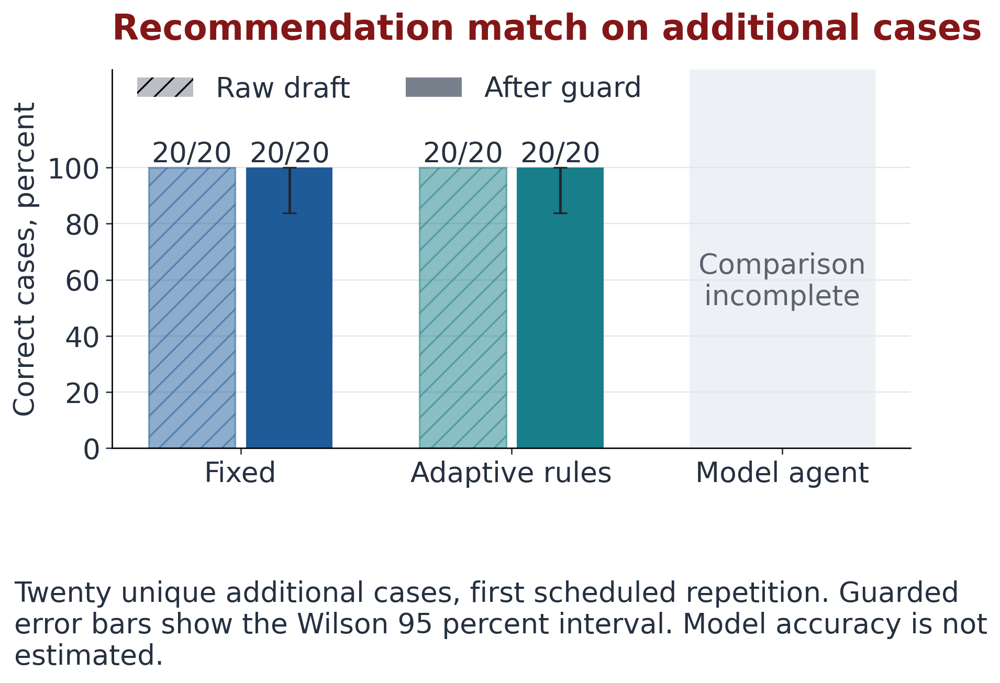

**Read it:** both offline methods match 20/20 first-run labels before and after the guard. Error bars show the recorded Wilson 95% interval for guarded accuracy. Model accuracy is not estimated from the failed, incomplete schedule.

[CSV](docs/assets/figures/accuracy.csv) · [SVG](docs/assets/figures/accuracy.svg) · [Figure provenance](docs/assets/figures/figure_manifest.json)

### Validation effort

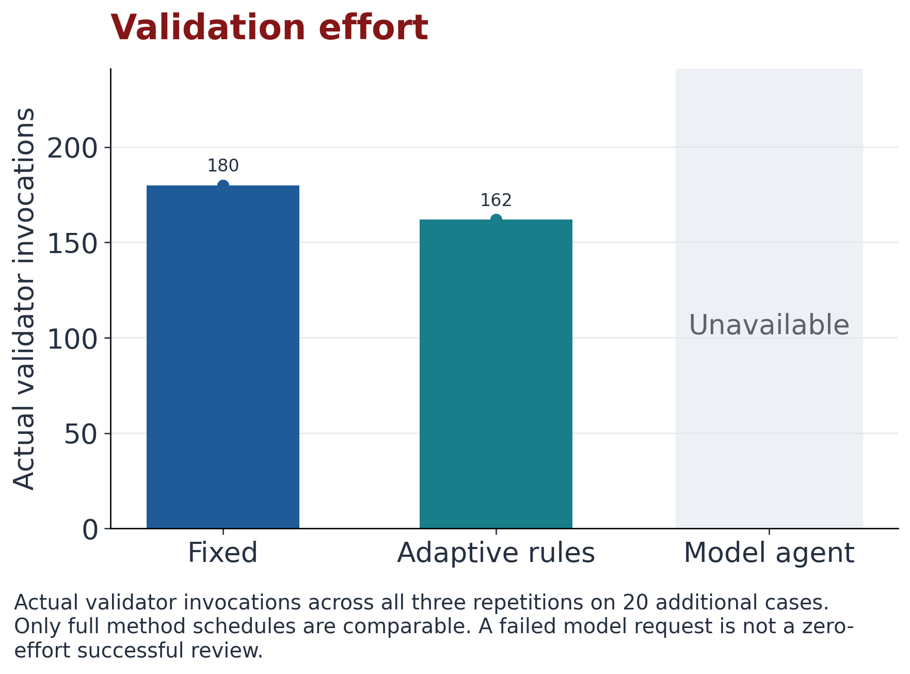

**Read it:** fixed checks total 180 invocations; adaptive rules total 162 across three repetitions. The failed model request's zero recorded tool events are not presented as a successful zero-effort method.

[CSV](docs/assets/figures/effort.csv) · [SVG](docs/assets/figures/effort.svg)

### Completed review time

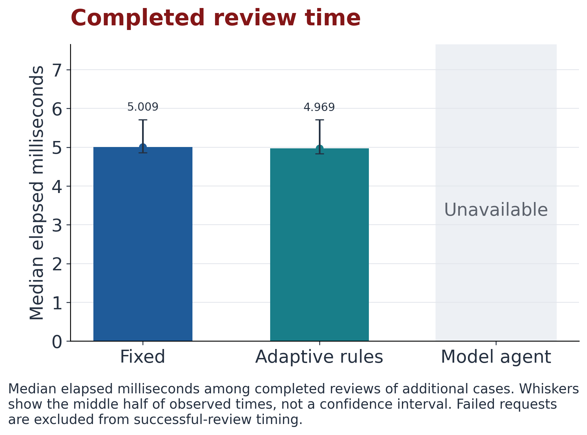

**Read it:** fixed median is 5.009 ms; adaptive median is approximately 4.969 ms. Whiskers show the middle half of observed durations, not a confidence interval. These small descriptive differences do not establish a statistically supported speed advantage.

[CSV](docs/assets/figures/latency.csv) · [SVG](docs/assets/figures/latency.svg)

### Provider charges

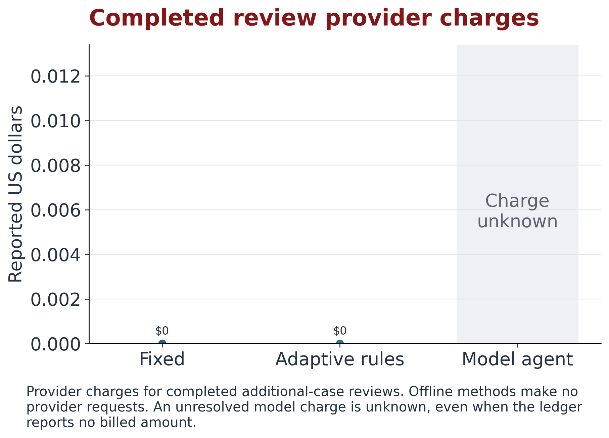

**Read it:** offline methods make no provider requests, so provider charge is zero. The failed model request's charge is unknown. This metric excludes local compute, hosting, maintenance, and human labor.

[CSV](docs/assets/figures/cost.csv) · [SVG](docs/assets/figures/cost.svg) · [Ledger](evidence/study40/budget.json)

### Individual additional-case outcomes

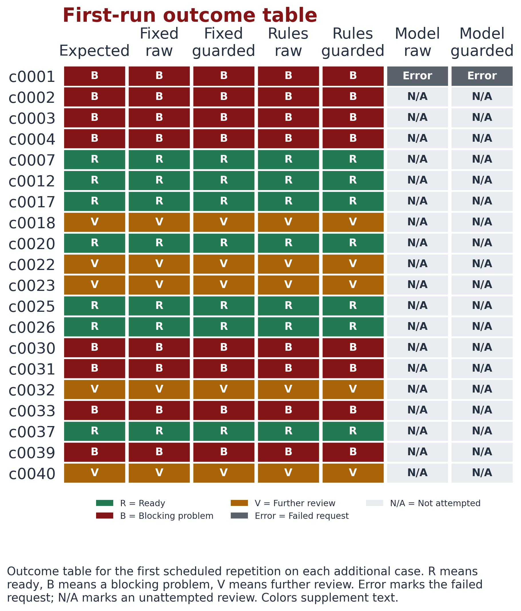

**Read it:** `R` is ready, `B` a blocking problem, and `V` further review. `Error` identifies the failed model request; `N/A` means unattempted. The matrix preserves case-level variation that aggregate accuracy can hide.

[CSV](docs/assets/figures/case_outcomes.csv) · [SVG](docs/assets/figures/case_outcomes.svg) · [Review explorer](docs/review.md)

### Combined effort, time, and cost

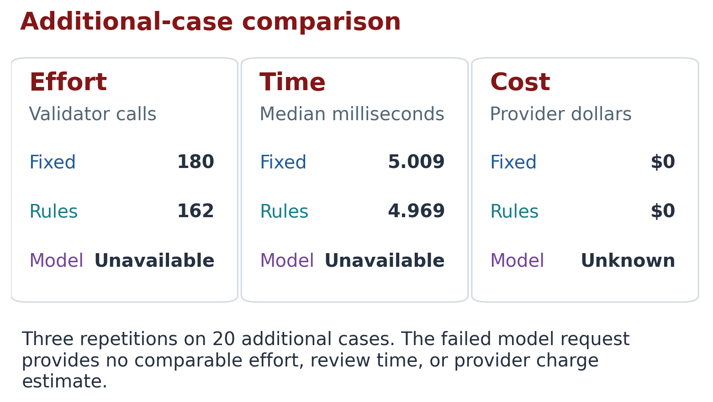

**Read it:** these quantities have different units. Fewer requests alone do not establish a lower total cost or faster human review.

[CSV](docs/assets/figures/effort_latency_cost.csv) · [SVG](docs/assets/figures/effort_latency_cost.svg)

### Machine-readable chart tables

| Figure | Exact table | Observation unit |
| --- | --- | --- |
| Benchmark composition | [benchmark_split.csv](docs/assets/figures/benchmark_split.csv) | Split × expected category, plus totals |
| Accuracy | [accuracy.csv](docs/assets/figures/accuracy.csv) | Method; first-run matches and planned case denominator |
| Effort | [effort.csv](docs/assets/figures/effort.csv) | Method; invocations and schedule completion |
| Time | [latency.csv](docs/assets/figures/latency.csv) | Method; completed-review median milliseconds |
| Charge | [cost.csv](docs/assets/figures/cost.csv) | Method; USD or unavailable value |
| Case outcomes | [case_outcomes.csv](docs/assets/figures/case_outcomes.csv) | Additional case; expected/raw/guarded outcomes |
| Combined | [effort_latency_cost.csv](docs/assets/figures/effort_latency_cost.csv) | Method × metric, unit, comparison eligibility |

[figure_manifest.json](docs/assets/figures/figure_manifest.json) records source hashes, captions, and PNG/SVG hashes for the seven families. [Original harness figures](prototypes/legacy-harness/results/figures/) remain separate.

## 8. Dataset catalog

### Original conformance data

| File or collection | Contents | Use |
| --- | --- | --- |
| [statistical_summary.json](evidence/legacy/statistical_summary.json) | Aggregate detection and timing | Trace original headline results |
| [primary_results.csv](prototypes/legacy-harness/results/primary_results.csv) | 40 rows: 20 modules × 2 methods | Decisions, faults, diagnoses, checks, scores, digests |
| [repeated_runs.csv](prototypes/legacy-harness/results/repeated_runs.csv) | 800 repeated execution rows | Original timing variation |
| [method_summary.csv](prototypes/legacy-harness/results/method_summary.csv) | 2 method rows | Original aggregate metrics and intervals |
| [Evidence packages](prototypes/legacy-harness/results/evidence_packages/) | Per-candidate records | Original finding evidence |
| [Protocol](prototypes/legacy-harness/EXPERIMENT_PROTOCOL.md), [dictionary](prototypes/legacy-harness/DATA_DICTIONARY.md) | Original definitions/procedure | Correct interpretation of legacy columns |

The 40 primary rows and 800 repeated rows are different collections, not additional independent cases.

### Earlier pilot data

| File | Contents | Use |
| --- | --- | --- |
| [baseline_cases.json](evidence/pilot/baseline_cases.json) | Fixed case records | Pilot fixed decisions |
| [baseline_summary.json](evidence/pilot/baseline_summary.json) | Fixed aggregate record | Fixed totals |
| [openrouter_cases.json](evidence/pilot/openrouter_cases.json) | Model case records | Decisions and usage |
| [openrouter_summary.json](evidence/pilot/openrouter_summary.json) | Model aggregate record | Model totals |
| [hosted_analysis.json](evidence/pilot/hosted_analysis.json) | Sanitized comparison | Public-table source |
| [codespace_test_results.txt](evidence/pilot/codespace_test_results.txt) | Preserved test output | Recorded test receipt |

Pilot tool counts represent distinct validator names; its citation measure checks nonempty strings. These differ from the new event counts and artifact/field validation.

### New benchmark data

| File or collection | Contents / grain | Use |
| --- | --- | --- |
| [packages/](evidence/study40/packages/) | 40 packages, `c0001` through `c0040` | Exact inputs, including omissions and malformed records |
| [labels.json](evidence/study40/labels.json) | One expected disposition/finding set per case | Labels, split, purpose, required tools, review status |
| [settings.json](evidence/study40/settings.json) | Frozen execution and measurement settings/amendments | Configuration identity |
| [system_prompt.txt](evidence/study40/system_prompt.txt) | Model instructions | Permitted agent behavior |
| [freeze.json](evidence/study40/freeze.json) | Input hashes and disclosure | Detect source/configuration changes |
| [rows.json](evidence/study40/rows.json) | 241 case × method × repetition attempt rows | Status, decisions, findings, references, effort, usage, time, charge |
| [cases.csv](evidence/study40/cases.csv) | Same 241 attempt rows in CSV | Spreadsheet/statistical use; despite its name, run-level data |
| [summary.json](evidence/study40/summary.json) | Six split × method groups and environment/status | Underlying aggregate and schedule accounting |
| [traces/](evidence/study40/traces/) | 241 public traces keyed by run ID | Tool results, events, guard, source fingerprints |
| [record_manifest.json](evidence/study40/record_manifest.json) | 241 entries with record/trace hashes | Connect public export to preserved source records |
| [budget.json](evidence/study40/budget.json) | Ceiling, pricing snapshot, reservation, failure, stop reason | Unresolved cost and paid execution stop |

### Presentation data

| File | Role | Relationship to study records |
| --- | --- | --- |
| [study_summary.json](docs/assets/study_summary.json) | Generates public result tables | Keeps studies separate; unavailable model estimates `null` |
| [reviews.json](docs/assets/reviews.json) | 241 reader-facing records | Identifiers, events, findings, source links, failure status |
| [Chart CSVs](docs/assets/figures/) | Exact figure values | Units, missing values, comparison eligibility |
| [Figure manifest](docs/assets/figures/figure_manifest.json) | Figure/source provenance | Links chart inputs and image bytes to checked sources |

Use canonical rows/traces for detailed research and the public summary for reader tables. Source-summary placeholder zeros for unexecuted model slots are not measured accuracy; the public summary leaves those estimates unavailable.

## 9. Frozen case catalog

These labels describe intentional synthetic mutations. Expected labels remain separate from model inputs; their presence here does not establish independent review.

<details>
<summary><strong>Expand the complete catalog of 40 cases</strong></summary>

| Case / package | Split | Expected disposition | Purpose | Expected findings |
| --- | --- | --- | --- | --- |
| [c0001](evidence/study40/packages/c0001/) | Additional | `not_ready` | Test totals do not add up | `TEST_COUNTS` |
| [c0002](evidence/study40/packages/c0002/) | Additional | `not_ready` | Interface paths has the wrong structure | `INTERFACE_SHAPE` |
| [c0003](evidence/study40/packages/c0003/) | Additional | `not_ready` | Two known faults occur together | `INTERFACE_VERSION`, `TEST_FAILURES` |
| [c0004](evidence/study40/packages/c0004/) | Additional | `not_ready` | Nested response type is absent | `RESPONSE_TYPE_0` |
| [c0005](evidence/study40/packages/c0005/) | Development | `needs_review` | SBOM validator unavailable | `TOOL_UNAVAILABLE_2` |
| [c0006](evidence/study40/packages/c0006/) | Development | `not_ready` | Wrong SBOM format | `SBOM_FORMAT` |
| [c0007](evidence/study40/packages/c0007/) | Additional | `ready` | Additional valid package variant | None (control) |
| [c0008](evidence/study40/packages/c0008/) | Development | `not_ready` | Recorded failing tests | `TEST_FAILURES` |
| [c0009](evidence/study40/packages/c0009/) | Development | `not_ready` | Interface version mismatch | `INTERFACE_VERSION` |
| [c0010](evidence/study40/packages/c0010/) | Development | `ready` | Conformant alternate build control | None (control) |
| [c0011](evidence/study40/packages/c0011/) | Development | `not_ready` | Missing contract endpoint | `ENDPOINT_MISSING_0` |
| [c0012](evidence/study40/packages/c0012/) | Additional | `ready` | Additional valid package variant | None (control) |
| [c0013](evidence/study40/packages/c0013/) | Development | `not_ready` | Dependency mismatch | `INTERFACE_DEPENDENCIES` |
| [c0014](evidence/study40/packages/c0014/) | Development | `not_ready` | Missing component version | `COMPONENT_VERSION_0` |
| [c0015](evidence/study40/packages/c0015/) | Development | `not_ready` | Tests identify a different build | `TEST_BUILD_ID` |
| [c0016](evidence/study40/packages/c0016/) | Development | `ready` | Untrusted instruction text in ignored metadata | None (control) |
| [c0017](evidence/study40/packages/c0017/) | Additional | `ready` | Additional valid package variant | None (control) |
| [c0018](evidence/study40/packages/c0018/) | Additional | `needs_review` | Additional absent artifact | `MISSING_INTERFACE` |
| [c0019](evidence/study40/packages/c0019/) | Development | `not_ready` | Malformed interface JSON | `PARSE_INTERFACE` |
| [c0020](evidence/study40/packages/c0020/) | Additional | `ready` | Additional valid package variant | None (control) |
| [c0021](evidence/study40/packages/c0021/) | Development | `needs_review` | Missing SBOM | `MISSING_SBOM` |
| [c0022](evidence/study40/packages/c0022/) | Additional | `needs_review` | Additional absent artifact | `MISSING_TESTS` |
| [c0023](evidence/study40/packages/c0023/) | Additional | `needs_review` | Additional absent hash | `PROVENANCE_TESTS` |
| [c0024](evidence/study40/packages/c0024/) | Development | `ready` | Conformant control | None (control) |
| [c0025](evidence/study40/packages/c0025/) | Additional | `ready` | Additional valid package variant | None (control) |
| [c0026](evidence/study40/packages/c0026/) | Additional | `ready` | Additional valid package variant | None (control) |
| [c0027](evidence/study40/packages/c0027/) | Development | `not_ready` | Response type mismatch | `RESPONSE_TYPE_0` |
| [c0028](evidence/study40/packages/c0028/) | Development | `needs_review` | Missing provenance | `MISSING_PROVENANCE` |
| [c0029](evidence/study40/packages/c0029/) | Development | `needs_review` | Missing provenance hash | `PROVENANCE_MANIFEST` |
| [c0030](evidence/study40/packages/c0030/) | Additional | `not_ready` | Endpoint field has the wrong type | `ENDPOINT_FIELDS_0` |
| [c0031](evidence/study40/packages/c0031/) | Additional | `not_ready` | Component has the wrong structure | `COMPONENT_SHAPE_0` |
| [c0032](evidence/study40/packages/c0032/) | Additional | `needs_review` | Evidence intake tool unavailable | `TOOL_UNAVAILABLE_0` |
| [c0033](evidence/study40/packages/c0033/) | Additional | `not_ready` | Hash record has the wrong structure | `PROVENANCE_SHAPE` |
| [c0034](evidence/study40/packages/c0034/) | Development | `not_ready` | Duplicate component reference | `DUPLICATE_BOM_REF_1` |
| [c0035](evidence/study40/packages/c0035/) | Development | `not_ready` | Synthetic advisory match | `ADVISORY_0` |
| [c0036](evidence/study40/packages/c0036/) | Development | `not_ready` | Provenance hash mismatch | `HASH_MANIFEST` |
| [c0037](evidence/study40/packages/c0037/) | Additional | `ready` | Additional valid package variant | None (control) |
| [c0038](evidence/study40/packages/c0038/) | Development | `needs_review` | Missing manifest | `MISSING_MANIFEST` |
| [c0039](evidence/study40/packages/c0039/) | Additional | `not_ready` | Test record names another module | `TEST_MODULE_ID` |
| [c0040](evidence/study40/packages/c0040/) | Additional | `needs_review` | Creation time cannot be checked | `PROVENANCE_DATE` |

</details>

Source: [labels.json](evidence/study40/labels.json). Cases cover valid controls, missing records, malformed JSON, identities, contracts, inventories, provenance, unavailable tools, and ignored untrusted instruction text.

## 10. Data dictionary

### Labels and join keys

| Key | Meaning | Use |
| --- | --- | --- |
| `case_id` | Neutral ID such as `c0001` | Join labels, rows, reviews, packages |
| `package` | Evidence folder | Locate inputs |
| `split` | `development` or `heldout` | Separate reported populations |
| Label `disposition` | Expected `ready`, `needs_review`, `not_ready` | Recommendation comparison |
| `fault_ids` | Expected finding-ID set | Missed/extra finding comparison |
| `required_tools` | Expected validators | Tool-coverage interpretation |
| `disabled_tool` | Deliberately unavailable validator, if any | Planned failure-case context |
| `purpose` | Mutation/control explanation | Case interpretation |
| `run_id` | Unique recorded attempt ID | Join trace and manifest |
| `(case_id, mode, repeat)` | Unique recorded scheduled slot | Duplicate detection; avoid joining on case ID alone |

### Outcomes and findings

| Field | Meaning | Interpretation rule |
| --- | --- | --- |
| `mode` | `baseline`, `adaptive`, `openrouter` | Analyze methods separately |
| `repeat` | Scheduled repetition 1-3 | First for primary accuracy; completed repeats for timing/stability |
| `status`, `failure_kind` | Completed/failed and category | Preserve failures separately |
| `expected` | Copied expected disposition | Row-level comparison |
| `raw_disposition` | Canonical pre-guard value | Inspect fallback/failure context for failed requests |
| `guarded_disposition` | Post-guard value | Does not imply human approval |
| `raw_correct`, `guarded_correct` | Label agreement | Row flags are not full-method performance estimates |
| `finding_ids` | Observed IDs | Compare expected set |
| `missed_findings`, `extra_findings` | Omitted / unsupported findings | Separate from disposition correctness |
| `raw_missed_findings`, `raw_extra_findings` | Pre-guard set differences | Guard effect |
| `faults_exact` | Exact finding-set match | More specific than correct disposition |
| `guard_intervention` | Recorded change or constraint | Read trace for reason |
| `source_unchanged` | Source-consistency check | Byte identity, not authenticity |

### References, effort, and usage

| Field | Meaning / unit | Interpretation rule |
| --- | --- | --- |
| `reference_count`, `valid_reference_count` | Citations / resolving artifact-field citations | `0/0` establishes no validated citation evidence |
| `all_references_valid` | Validity flag | True with no references does not prove coverage |
| `tool_tp`, `tool_fp`, `tool_fn` | Tool-selection counts against expected coverage | Read with required tools and guard events |
| `tool_invocations` | Every validator event | Repeated calls count again |
| `distinct_tools` | Unique validator names | Can differ from invocations |
| `model_calls`, `request_attempts` | Calls / HTTP attempts | Failure is still an attempt |
| `input_tokens`, `output_tokens` | Reported token counts | Failure placeholder zeros do not establish free successful reviews |
| `elapsed_ms` | Attempt milliseconds | Filter completed reviews for successful-review latency |
| `cost_usd` | Provider USD or `null` | Zero and unknown differ |

JSON preserves lists and `null`. CSV stores list-valued fields as JSON text and unavailable numeric values as empty cells. Preserve these meanings when importing.

### Provenance and file integrity

Current freeze SHA-256:

```text
70258896ad3335b10dd19217d819c7dbd25934615091612bc0b260314047055f
```

| Record | Identity established |
| --- | --- |
| [freeze.json](evidence/study40/freeze.json) | Input, label, prompt, setting hashes |
| [record_manifest.json](evidence/study40/record_manifest.json) | Export rows, summary, individual records, traces |
| Trace `package_fingerprint`, `artifact_hashes` | Evidence bytes for that review |
| [figure_manifest.json](docs/assets/figures/figure_manifest.json) | Chart sources and image exports |
| Summary [environment](evidence/study40/summary.json) | Recorded Python/platform, source commit, model, profile, prompt, freeze |

Hashes establish byte identity, not truth, signer authenticity, label independence, or applicability elsewhere. The frozen source commit describes the class-source context; public Git history identifies the companion version.

## 11. Worked evidence review

### Case `c0001`: inconsistent test totals

The [package](evidence/study40/packages/c0001/) contains this [test record](evidence/study40/packages/c0001/tests.json):

```json
{
  "module_id": "mosa-demo-module",
  "build_id": "build-001",
  "total": 13,
  "passed": 12,
  "failed": 0
}
```

**12 passed + 0 failed = 12**, while total is **13**. Expected disposition is `not_ready` with finding `TEST_COUNTS`.

| Item | Recorded evidence |
| --- | --- |
| Slot | `c0001`, additional split, `baseline`, repetition 1 |
| Run ID | `7fccb909350c46f4bc2282367d8b6979` |
| Calls | `inspect_evidence_package`, `validate_interface_contract`, `verify_sbom_and_advisories` |
| Finding | `TEST_COUNTS`, severity `blocker` |
| Citation | `tests.json`, field `/total`; validated |
| Raw / guarded | `not_ready` / `not_ready` |
| Guard intervention | False for this completed fixed review |
| Time | 6.546 ms for this individual review |
| Provider charge | $0; no model call |
| Recorded remediation | Correct the test summary |

[Full trace](evidence/study40/traces/7fccb909350c46f4bc2282367d8b6979.json) · [Canonical rows](evidence/study40/rows.json) · [Review explorer](docs/review.md)

### Failed model attempt on the same case

Run `b35ae22cdb134acbab1fdd85f5916ad4` records an API failure, zero validator calls, and unknown charge. Its 140.205 ms duration describes the failed attempt, excluded from completed-review timing.

The `needs_review` fallback preserves uncertainty. It is not a completed model recommendation supported by findings. The saved reader leaves the raw model disposition unavailable and retains fallback context. [Failed trace](evidence/study40/traces/b35ae22cdb134acbab1fdd85f5916ad4.json).

This example connects a source field, finding, recommendation, trace, and limitation without access to the private prototype.

## 12. Repository map

```text
mosa-evidence-review-thesis/
├── README.md                       Project and evidence guide
├── CITATION.cff                    Citation metadata
├── LICENSE                         Author rights and inherited notices
├── mkdocs.yml                      Site navigation/configuration
├── requirements-site.in            Website dependency inputs
├── requirements-site.txt           Exact website package pins
├── requirements-research.txt       Figure dependencies
├── .github/workflows/pages.yml     Verification and Pages deployment
├── diagrams/                       Four editable Mermaid sources
├── docs/
│   ├── index.md                    Reader orientation
│   ├── thesis.md                   PDF downloads and chapter guide
│   ├── review.md                   Saved review explorer
│   ├── results.md                  Generated results
│   ├── research-design.md          Methods, cases, metrics, budget
│   ├── reproduce.md                Reproduction instructions
│   ├── diagrams.md                 Diagram explanations/exports
│   ├── glossary.md                 Terminology
│   ├── changes.md                  Thesis revision/reduction map
│   ├── migration.md                Future transfer procedure
│   ├── sources.md                  Sources/rights
│   └── assets/
│       ├── downloads/              Original/revised PDFs and checksum manifest
│       ├── study_summary.json      Multi-study public summary
│       ├── reviews.json            Reader-facing saved records
│       ├── figures/                Seven chart families, CSVs, manifest
│       ├── diagrams/               PNG/SVG exports
│       ├── javascripts/readers.js   Review filtering/rendering
│       └── stylesheets/thesis.css  Site presentation
├── evidence/
│   ├── legacy/                     Original aggregate record
│   ├── pilot/                      Sanitized pilot records
│   └── study40/
│       ├── packages/               Forty synthetic case inputs
│       ├── traces/                 Per-attempt public traces
│       ├── labels.json             Expected labels/review status
│       ├── settings.json           Frozen configuration
│       ├── freeze.json             Input hashes/disclosure
│       ├── rows.json               Canonical attempt rows
│       ├── cases.csv               CSV attempt-row export
│       ├── summary.json            Split/method aggregates
│       ├── record_manifest.json    Record/trace provenance
│       ├── system_prompt.txt       Agent instructions
│       └── budget.json             Charge accounting/stop reason
├── prototypes/legacy-harness/      Original source and recorded results
├── thesis/                         Revised source, builders, figure map
├── tests/                          Public integrity/reader checks
└── tools/                          Table, figure, diagram maintenance
```

[.gitignore](.gitignore) excludes environments, generated `site/`, caches, and private `.env` files. The complete thesis PDFs are checked into [docs/assets/downloads/](docs/assets/downloads/); MkDocs includes them in the website build.

### Maintenance tools

| Tool | Function | Expected effect |
| --- | --- | --- |
| [render_public_data.py](tools/render_public_data.py) | Generates verified README/results blocks | `--check` verifies; without it, rewrites tables |
| [generate_figures.py](tools/generate_figures.py) | Checks sources/traces; creates PNG, SVG, CSV, manifest | Requires plotting dependencies and rewrites exports |
| [sync_diagrams.py](tools/sync_diagrams.py) | Aligns README/diagram-page Mermaid with `.mmd` | Rewrites blocks; image exports also need updates when content changes |
| [build_thesis_docx.py](thesis/build_thesis_docx.py) | Builds Word from structured thesis content | Requires later field, layout, page review |
| [read_pdf_page_map.py](thesis/read_pdf_page_map.py) | Supports page-reference mapping | Final-document preparation |

## 13. Quick start

### Prerequisites

| Requirement | Purpose |
| --- | --- |
| Git | Clone and identify the source version |
| Python 3.11 | Documented reproduction runtime |
| Node.js with `node --test` support | Reader JavaScript checks |
| [Pinned site packages](requirements-site.txt) | MkDocs Material build |

Building or inspecting the public reading site requires no model credential.

### Clone and create an environment

```bash
git clone https://github.com/CloudWizardBoricua/mosa-evidence-review-thesis.git
cd mosa-evidence-review-thesis
python -m venv .venv
```

| Platform / shell | Activate |
| --- | --- |
| Linux / macOS | `source .venv/bin/activate` |
| Windows PowerShell | `.\.venv\Scripts\Activate.ps1` |

### Install, verify, and build

Run from the repository root:

```bash
python -m pip install -r requirements-site.txt
python tools/render_public_data.py --check
python -m unittest discover -s tests -p "test_public_site.py" -v
node --test tests/test_reader_interactions.js
python -m mkdocs build --strict
```

All checks should succeed before publication. Strict build writes the website to `site/`.

### Preview the website

```bash
python -m mkdocs serve
```

Open the local address MkDocs prints. The reader uses saved JSON and makes no model request. Stop the development server with `Ctrl+C`.

### Inspect attempt rows with Python

This read-only example distinguishes attempts from completed reviews:

```python
import json
from collections import Counter
from pathlib import Path

rows = json.loads(Path("evidence/study40/rows.json").read_text(encoding="utf-8"))
print("Recorded attempts:", len(rows))
print("Statuses:", dict(Counter(row["status"] for row in rows)))
print("Methods:", dict(Counter(row["mode"] for row in rows)))
```

The frozen export has 241 attempts: 240 `completed`, 1 `failed`; methods have 120 `baseline`, 120 `adaptive`, and 1 `openrouter` rows.

### Original harness and current class study

The [full reproduction guide](docs/reproduce.md) covers the separate legacy environment and class capstone commands. Run fresh reproductions in a separate checkout and compare logical outcomes with preserved evidence. Timing varies across machines.

The current capstone runner is not present at `prototypes/capstone/`; its paid study remains stopped. Use the configuration, ledger, and limitations when preparing any later evaluation.

### Troubleshooting

| Symptom | Check |
| --- | --- |
| Cannot import MkDocs | Activate the intended environment; install site requirements using that Python |
| Generated result check fails | Compare public summary and marked blocks; regenerate only after verifying the intended source update |
| Strict build reports missing link/image | Confirm file exists and relative path is correct |
| Reader data unavailable | Confirm `reviews.json`; use MkDocs server rather than directly opening generated HTML |
| Mermaid unavailable | Use linked PNG/SVG fallbacks |
| PDF preview does not load | Open the file's GitHub page and select its download button, or use the PDF links on the reading website |
| Pages deployment fails | Inspect workflow run and repository Pages configuration; local build and remote deployment are separate |

## 14. Verification and publication

### Existing verification suite

| Check | Coverage |
| --- | --- |
| Result parity | README/results marked blocks match public summary |
| Identity and rights | Original title, retained rights, inherited-notice conflict |
| Summary integrity | Case counts, ranges, budget, separate studies |
| Review integrity | Unique IDs, dispositions, sources, event-based tool counts |
| Documentation | Links, image exports, synchronized Mermaid |
| Public boundaries | Selected exports exclude credentials, private approvals, temporary addresses |
| Missing data | Unexecuted model results remain unavailable |
| Pilot fidelity | Original pilot measurements retained |
| Pins | Exact package versions and commit-pinned Actions |
| Reader behavior | Filtering, failed context, plain-text rendering, unavailable-data state |

The suite contains **11 Python tests and 3 JavaScript tests**. It checks the companion, not independent label quality, certification, or completion of the model evaluation.

### GitHub Actions

[pages.yml](.github/workflows/pages.yml) runs on `main` pushes, pull requests, and manual dispatch:

```text
Check out source
    ↓
Python 3.11 and pinned site dependencies
    ↓
Result parity → Python checks → Reader checks
    ↓
Strict MkDocs build
    ↓
Eligible push/manual run: upload site → deploy GitHub Pages
```

Pull requests verify without deploying. A separate deploy job uses Pages and identity-token permissions. Local success does not establish remote deployment success.

[Workflow runs](https://github.com/CloudWizardBoricua/mosa-evidence-review-thesis/actions) · [Reading website](https://cloudwizardboricua.github.io/mosa-evidence-review-thesis/)

### Maintaining this companion

1. Preserve frozen evidence bytes and failed attempts.
2. Record new configurations, label review, and amendments explicitly.
3. Update public exports from verified source records.
4. Regenerate marked tables with `python tools/render_public_data.py` after legitimate summary updates.
5. Regenerate chart data/images together, with their manifest.
6. Keep diagram text, sources, and image fallbacks consistent.
7. Run checks and strict build.
8. Inspect changes before committing/publishing.

The confirmed earlier thesis remains preserved separately. Presentation changes should not silently alter experimental outcomes.

## 15. Thesis source and document status

### Document status

| Item | Status | Location |
| --- | --- | --- |
| Formal title | Preserved | [Citation](CITATION.cff), [guide](docs/thesis.md) |
| Original PDF | Available; 130 pages; original Word source unchanged | [thesis-original.pdf](docs/assets/downloads/thesis-original.pdf) |
| Revised PDF | Available; 52 pages; contents, figure references, and all pages checked | [thesis-revised.pdf](docs/assets/downloads/thesis-revised.pdf) |
| PDF provenance | Page counts, SHA-256 checksums, source identity, export method | [pdf_manifest.json](docs/assets/downloads/pdf_manifest.json) |
| Structured argument | Available | [thesis_content.json](thesis/thesis_content.json) |
| Study replacements | Available | [study_replacements.json](thesis/study_replacements.json) |
| Figure map | Available | [figure_map.json](thesis/figure_map.json) |
| Word tools | Available | [builder](thesis/build_thesis_docx.py), [authoring tool](thesis/author_thesis.py) |
| Editable Word download | Not published; generation tools remain available | [PDF downloads](docs/thesis.md) |
| Committee approval | Not claimed | Revised research draft |

### Chapter guide

| Chapter / section | Purpose | Companion evidence |
| --- | --- | --- |
| Front matter/abstract | Problem, status, reading path | [Reader guide](docs/index.md) |
| 1. Problem/questions | Why claims need verifiable evidence | [Scope](#2-research-scope) |
| 2. Foundations | MOSA principles and original harness | [Legacy prototype](prototypes/legacy-harness/) |
| 3. Design/human review | Tools, guard, identity, decisions | [Architecture](#3-system-architecture), [lifecycle](#4-review-and-human-decision-lifecycle) |
| 4. Method | Cases, labels, splits, repeats, metrics, budget | [Research design](docs/research-design.md) |
| 5. Results/discussion | Recorded outcomes and incomplete comparison | [Results](#6-recorded-results), [charts](#7-chart-gallery) |
| 6. Conclusions/future work | Supported findings and remaining evaluation | [Limits](#16-research-limits), [roadmap](#17-roadmap-and-migration) |
| References/glossary/appendix | Sources, terms, procedures | [Sources](docs/sources.md), [glossary](docs/glossary.md), [reproduction](docs/reproduce.md) |

[What changed](docs/changes.md) explains the revision/reduction plan. Read the PDFs for the complete documents; the Markdown pages provide companion guidance. The revised PDF was generated from the current structured content and exported through Microsoft Word after updating navigation fields. Its [page map](thesis/page_map.json) records verified locations. The original PDF preserves the original document's existing content, layout, and static navigation references. Neither export establishes approval of the revision.

## 16. Research limits

| Limit | Effect on interpretation |
| --- | --- |
| Synthetic examples | Planted faults/controls do not span operational evidence |
| Pending label review | Correctness means agreement with researcher labels whose review is unfinished |
| Preflight exposure | Additional cases supported a structural fix before final freeze |
| Incomplete model schedule | One failure cannot establish accuracy, successful time, stability, or spending |
| Small case denominator | 20 unique cases per split; repeats are not independent cases |
| Different dataset definitions | Legacy checks, pilot counts/citations, new events/location metrics differ |
| Synthetic advisories | Bounded fixture, not live vulnerability assessment |
| Source hashes | Consistency is not authenticity or truth |
| Provider-only cost | Excludes compute and human labor |
| Environment/fixed schedule | Milliseconds depend on the recorded environment and order |
| Human decisions unmeasured | No demonstrated reduction in reviewer workload or decision risk |
| Profile scope | Ready does not certify a defense program |

The conclusion can favor explicit adaptive rules if their measured benefit is sufficient. The study does not require the model to outperform simpler methods.

## 17. Roadmap and migration

### Remaining work

| Work item | State | Evidence needed |
| --- | --- | --- |
| Revised thesis approval | Pending | Author and committee review of the published research draft |
| Author label verification | Pending | Recorded review and transparent corrections |
| Independent review | Pending | Named reviewer, date, scope, outcome |
| Failed provider charge | Unknown | Reconciled charge and ledger |
| Request compatibility | Unresolved | Verified configuration before further paid work |
| Model comparison | Incomplete | Remaining schedule, failures, usage, budget record |
| Result refresh | Follows verified evidence | Rows, summary, traces, manifests, charts, tables |
| Capstone migration | Deferred until after course submission | Tested commit, export manifest, fresh-checkout verification |

### Planned migration

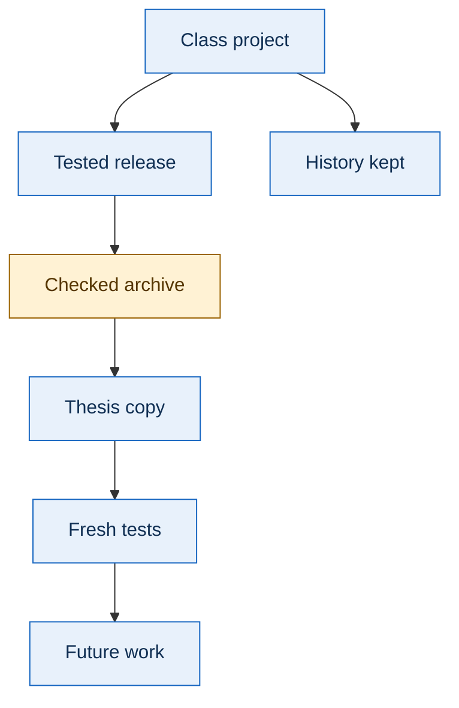

[Mermaid source](diagrams/migration.mmd) · [SVG](docs/assets/diagrams/migration.svg) · [PNG fallback](docs/assets/diagrams/migration.png)

Transfer copies a tested release into future directory `prototypes/capstone/` and preserves submitted class history. It requires the actual source commit, file hashes, configuration, and fresh checkout tests. That destination is not an available implementation today.

The [migration guide](docs/migration.md) lists allowed paths and `MIGRATION.json` fields. Exclude live credentials, private approval state, temporary addresses, caches, and unrelated coursework.

## 18. Citation and rights

### Citation

Use [CITATION.cff](CITATION.cff). Include author, formal title, revised-draft status, version, repository commit, and relevant dataset/run identifiers.

```text
Daren Jadiel Diaz.
A CONFORMANCE HARNESS FOR VERIFIABLE MODULAR OPEN SYSTEMS OUTCOMES
IN DEFENSE ACQUISITION: DESIGN, IMPLEMENTATION, AND CONTROLLED EVALUATION.
Revised research draft and companion repository, version 0.1.0.
https://github.com/CloudWizardBoricua/mosa-evidence-review-thesis
Study: thesis-study40-v1. Identify the commit and evidence used.
```

### Rights and inherited material

Author rights in new prose, software, figures, thesis content, and materials are retained under [LICENSE](LICENSE). Public access does not grant a general reuse or redistribution license.

The legacy harness retains [LICENSE.txt](prototypes/legacy-harness/LICENSE.txt) and [CITATION.cff](prototypes/legacy-harness/CITATION.cff). They contain conflicting license statements. The inherited MIT metadata is not adopted repository-wide; this companion does not resolve or relicense that artifact. Dependencies retain their respective licenses.

[Sources and rights](docs/sources.md) maps the evidence and supporting publication references. Publication and university colors imply no approval or endorsement.

---

[Back to contents](#contents) · [Thesis guide](docs/thesis.md) · [Results](docs/results.md) · [Review explorer](docs/review.md) · [Reproduction](docs/reproduce.md)
