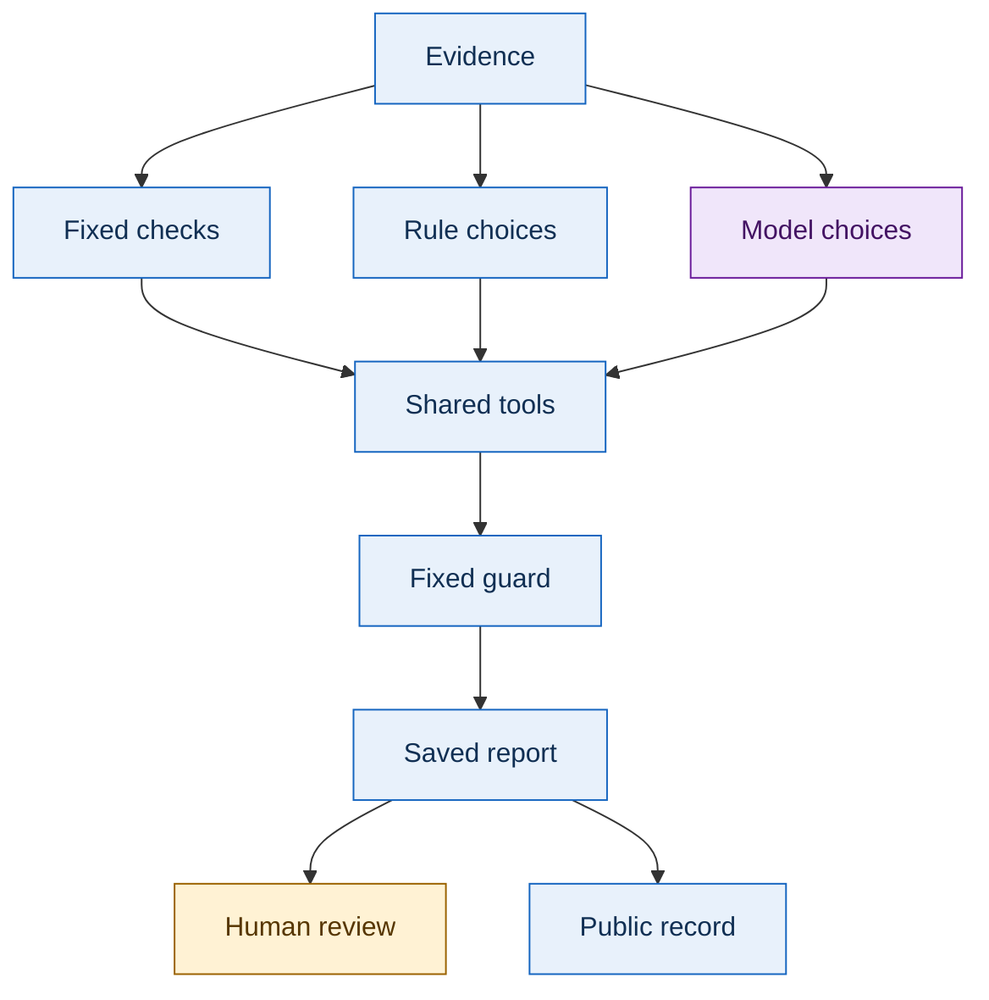
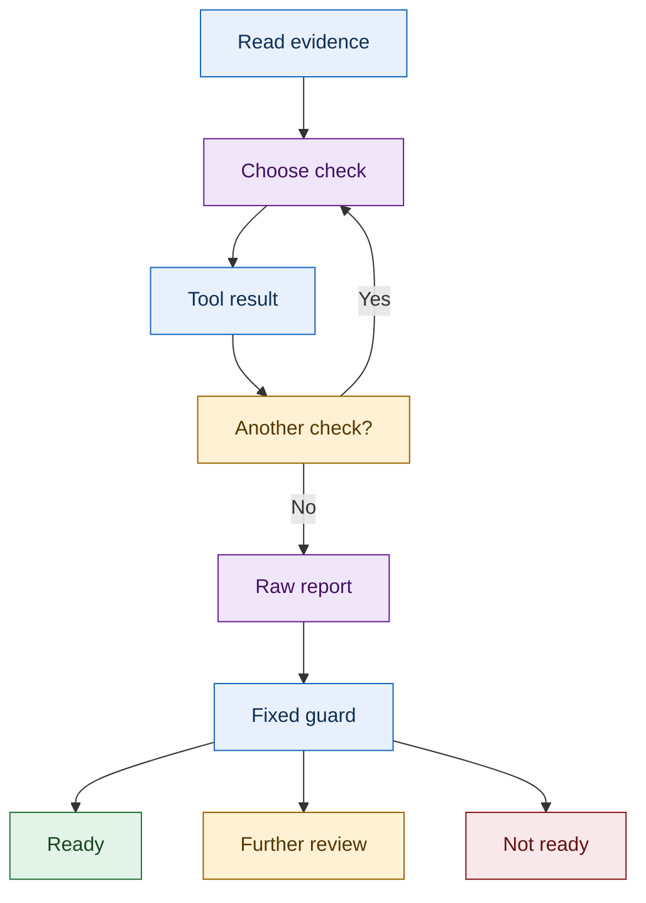
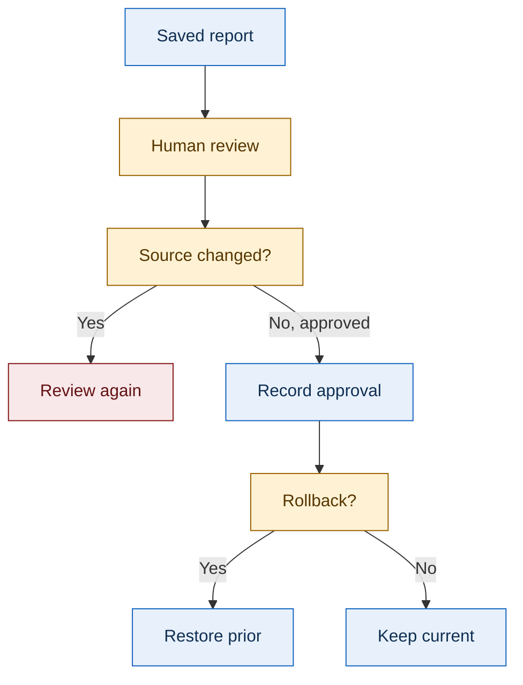
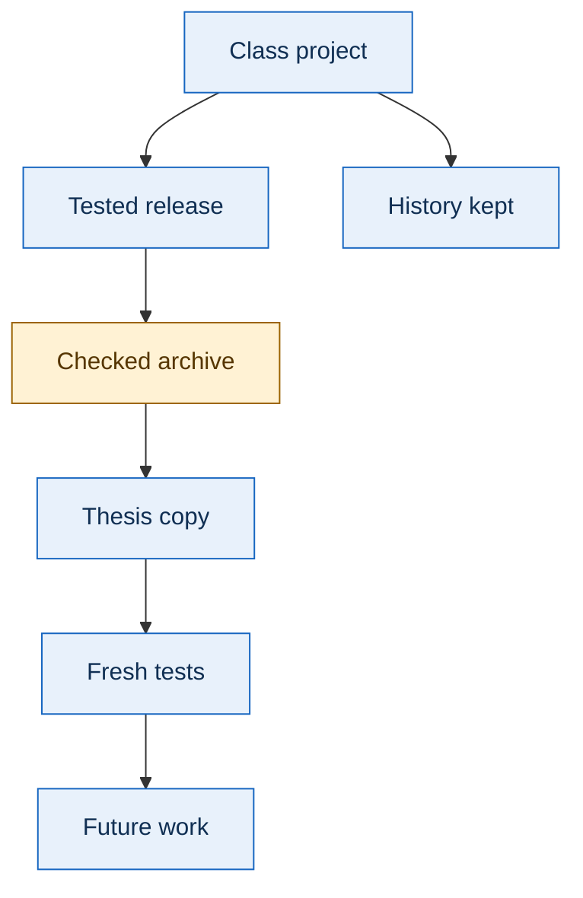

# System Diagrams

The diagrams show how the evidence moves through the review process. Each diagram has an image export and text source. Color labels distinguish evidence, model choices, uncertainty, and supported readiness.

## System topology

Topology means the arrangement of parts and connections. The three methods share the same validators and decision guard.

Fixed checks run every validator. Rule choices use explicit rules. Model choices come from the bounded agent. The shared tools inspect evidence, compare interfaces, and check the software inventory. The fixed guard checks coverage and support before the saved report reaches a person or the public reading record.

## Review sequence

The method can request a tool, inspect the returned facts, and choose another permitted action. Every request is counted. Another check is allowed only when needed and within the loop limit. A raw report records the method's recommendation before the fixed guard. The guard then returns ready, further review, or not ready, with evidence references.

## Approval and rollback

This diagram describes private prototype behavior. A person reviews evidence, the source fingerprint must match, and history remains available after rollback. A changed source requires another review. Restore prior means restore the previous approved pointer and append a history entry. Keep current means retain the current pointer and its recorded history.

## Migration after course submission

The class project stays in place after course submission. A checked archive contains a tested release, source commit, and file hashes. Its contents are copied into the thesis repository. Fresh tests run from a new independent checkout. The thesis copy then supports future work, while the original class history remains available.

## Diagram sources and fallback files

| Diagram | Editable source | PNG fallback |
| --- | --- | --- |
| System topology | [Mermaid source](https://github.com/CloudWizardBoricua/mosa-evidence-review-thesis/blob/main/diagrams/system_topology.mmd) | [PNG image](assets/diagrams/system_topology.png) |
| Review sequence | [Mermaid source](https://github.com/CloudWizardBoricua/mosa-evidence-review-thesis/blob/main/diagrams/review_sequence.mmd) | [PNG image](assets/diagrams/review_sequence.png) |
| Approval and rollback | [Mermaid source](https://github.com/CloudWizardBoricua/mosa-evidence-review-thesis/blob/main/diagrams/approval_rollback.mmd) | [PNG image](assets/diagrams/approval_rollback.png) |
| Migration | [Mermaid source](https://github.com/CloudWizardBoricua/mosa-evidence-review-thesis/blob/main/diagrams/migration.mmd) | [PNG image](assets/diagrams/migration.png) |

SVG means Scalable Vector Graphics. These images remain sharp when enlarged. PNG means Portable Network Graphics, a widely supported image format. Mermaid is the editable text description from which the diagrams are produced.
