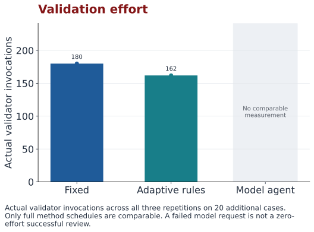
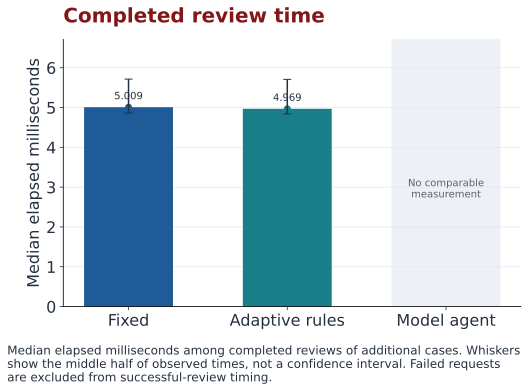
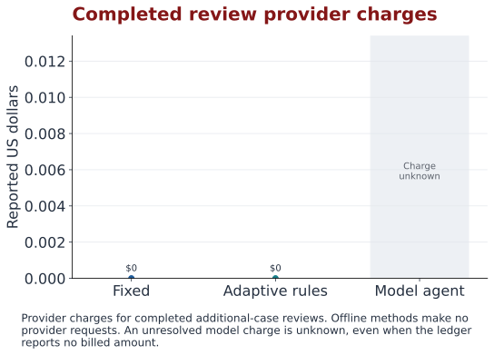
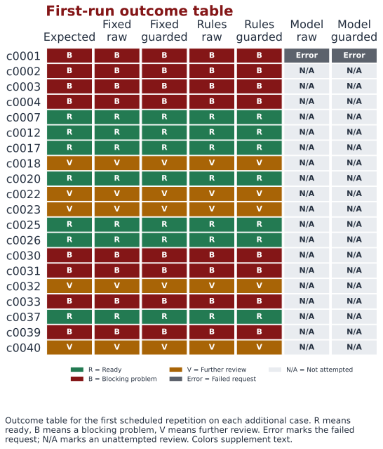

# Compare Results

Keep the original study, the capstone pilot, and the new benchmark separate. Their inputs and questions differ. A number from one study does not describe another study.

!!! warning "Amber: new model comparison is incomplete"
    The fixed and rule based methods completed the new benchmark. The model method's first hosted request failed with an HTTP 404 response. HTTP means Hypertext Transfer Protocol, the rules used for web requests; 404 means the requested resource was not found. Its provider charge was unknown, so the spending control stopped further paid requests. This is a recorded execution failure, not an accuracy comparison of the model across 20 cases. The earlier model pilot remains separate evidence.

<!-- BEGIN VERIFIED RESULTS -->
### Original conformance experiment

**Status:** recorded. Unique cases: 20. Recorded runs: 40.

| Method | Known faults detected | Controls accepted | Median elapsed time, ms |
| --- | ---: | ---: | ---: |
| Minimal baseline | 5/18 | 2/2 | 0.348 |
| Original conformance harness | 18/18 | 2/2 | 7.042 |

This earlier experiment compares different check sets. Its runtime and outcome measures are separate from the agent studies.

[Inspect the recorded source](https://github.com/CloudWizardBoricua/mosa-evidence-review-thesis/blob/main/evidence/legacy/statistical_summary.json).

### Earlier capstone pilot

**Status:** recorded. Unique cases: 20. Recorded runs: 40.

| Method | Unique cases | Recorded runs | Raw correct | Guarded correct | Tool invocations | Median elapsed time, ms | Recorded cost, USD |
| --- | ---: | ---: | ---: | ---: | ---: | ---: | ---: |
| Fixed workflow | 20 | 20 | 20/20 (100.0%) | 20/20 (100.0%) | 60 | 4.98 | 0 |
| Model agent | 20 | 20 | 17/20 (85.0%) | 20/20 (100.0%) | 51 | 3,916.684 | 0.020573 |

These descriptive-name development cases were run once per method. This pilot is separate from the neutral-case study.

The pilot measured distinct validator names; this study counts every validator trace event.

Its original citation measure checked nonempty strings and is not evidence of location validation.

[Inspect the recorded source](https://github.com/CloudWizardBoricua/mosa-evidence-review-thesis/blob/main/evidence/pilot/hosted_analysis.json).

### New benchmark: additional-case evaluation

**Status:** incomplete. Unique cases: 20. Recorded runs: 121.

| Method | Unique cases | Recorded runs | Raw correct | Guarded correct | Tool invocations | Median elapsed time, ms | Recorded cost, USD |
| --- | ---: | ---: | ---: | ---: | ---: | ---: | ---: |
| Fixed workflow | 20 | 60 | 20/20 (100.0%) | 20/20 (100.0%) | 180 | 5.009 | 0 |
| Rule based adaptive workflow | 20 | 60 | 20/20 (100.0%) | 20/20 (100.0%) | 162 | 4.969 | 0 |
| Model agent | 20 | 1 | Not reported | Not reported | 0 | Not reported | Not reported |

**Model agent: incomplete.** 1 of 60 planned runs recorded; 0 completed reviews with timing; 1 failed runs. A complete recommendation accuracy comparison is not available.

| Method | Missed findings | Extra findings | Valid references | Guard interventions | Fully repeated stable cases | Tokens |
| --- | ---: | ---: | ---: | ---: | ---: | ---: |
| Fixed workflow | 0 | 3 | 45/45 | 0 | 20/20 | 0 |
| Rule based adaptive workflow | 0 | 0 | 42/42 | 3 | 20/20 | 0 |
| Model agent | 1 | 0 | 0/0 | 1 | 0/0 | Not reported |

Findings, references, and guard interventions count recorded runs. Stable case counts require all planned repeats. These counts use a different denominator from unique-case recommendation accuracy.

Accuracy uses repetition 1 on each unique case. Three repetitions describe timing and stability.

An offline preflight led to a documented hash-container fix before the final freeze. These are additional synthetic cases, not untouched external holdout evidence.

Daren Diaz verification and independent label review are pending. This profile does not certify a defense system.

[Inspect the recorded source](https://github.com/CloudWizardBoricua/mosa-evidence-review-thesis/blob/main/evidence/study40/summary.json).

### New benchmark: development cases

**Status:** incomplete. Unique cases: 20. Recorded runs: 120.

| Method | Unique cases | Recorded runs | Raw correct | Guarded correct | Tool invocations | Median elapsed time, ms | Recorded cost, USD |
| --- | ---: | ---: | ---: | ---: | ---: | ---: | ---: |
| Fixed workflow | 20 | 60 | 20/20 (100.0%) | 20/20 (100.0%) | 180 | 5.12 | 0 |
| Rule based adaptive workflow | 20 | 60 | 20/20 (100.0%) | 20/20 (100.0%) | 156 | 5.033 | 0 |
| Model agent | 20 | 0 | Not executed | Not executed | Not executed | Not reported | Not reported |

**Model agent: pending.** 0 of 60 planned runs recorded; 0 completed reviews with timing; 0 failed runs. A complete recommendation accuracy comparison is not available.

| Method | Missed findings | Extra findings | Valid references | Guard interventions | Fully repeated stable cases | Tokens |
| --- | ---: | ---: | ---: | ---: | ---: | ---: |
| Fixed workflow | 0 | 9 | 60/60 | 0 | 20/20 | 0 |
| Rule based adaptive workflow | 0 | 0 | 51/51 | 0 | 20/20 | 0 |
| Model agent | Not executed | Not executed | Not executed | Not executed | Not executed | Not executed |

Findings, references, and guard interventions count recorded runs. Stable case counts require all planned repeats. These counts use a different denominator from unique-case recommendation accuracy.

Accuracy uses repetition 1 on each unique case. Three repetitions describe timing and stability.

An offline preflight led to a documented hash-container fix before the final freeze. These are additional synthetic cases, not untouched external holdout evidence.

Daren Diaz verification and independent label review are pending. This profile does not certify a defense system.

[Inspect the recorded source](https://github.com/CloudWizardBoricua/mosa-evidence-review-thesis/blob/main/evidence/study40/summary.json).

**New study budget:** $5 ceiling; recorded spending: Not reported. Unknown cost is never treated as zero.

**Paid study stopped:** Request failed and its provider charge is unknown.

Accuracy counts unique cases. Repeated runs measure stability and timing. Pilot invocation counts retain the original evaluator's definition; the new benchmark counts actual trace events.
<!-- END VERIFIED RESULTS -->

Loading the verified results export.

[Download the verified summary](assets/study_summary.json) · [Inspect saved case records](assets/reviews.json)

## Reading the charts

### Recommendations before and after the guard

A correct recommendation matches the expected answer for a unique case. A guard intervention means the fixed checks changed or constrained the raw recommendation. Matching researcher labels is not independent proof of real world readiness.

### Validation effort

Count every tool invocation, including repeated requests to the same tool. Counting distinct tool names can hide extra work. A tool invocation and a paid model request are different events.

### Elapsed time

Latency means elapsed time. A model can choose fewer checks and still take longer because communicating with a hosted service takes time. Timing depends on the machine, service, network, and study settings.

### Recorded model cost

Recorded cost covers reported service charges. It excludes reviewer time and other infrastructure costs. Missing cost information is shown as unknown, not as zero. The new paid study has a total spending ceiling of $5.

### Individual case outcomes

Inspect individual cases to see whether averages hide a recurring problem. Repeated runs describe stability and timing. They do not create additional independent cases for accuracy estimates.

!!! info "Blue: primary evaluation"
    Primary means the comparison used for the main conclusion. The new study reports 20 additional cases separately from 20 development cases. An offline preflight was used to correct a shared defect before the final freeze. The additional cases are not untouched external evaluation evidence.

## Evidence limits

All studies use synthetic examples. Label review, completed runs, failures, and unexecuted model comparisons must be reported explicitly. A model outage, a budget stop, or unavailable cost information is part of the record. An unexecuted comparison cannot be presented as a measured result.

The pilot's reported 51 versus 60 tool calls came from its original evaluator. The new evaluator counts every invocation from the event trace. This avoids treating a distinct tool name as a complete count.

Read [the research design](research-design.md) for case composition, metrics, and labels. Read [the source and rights notes](sources.md) for provenance, which means the record of where an artifact came from.
